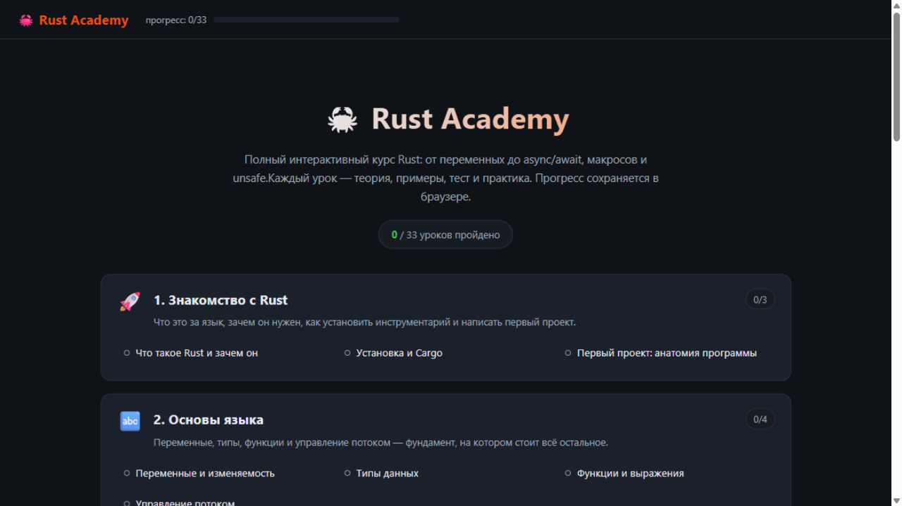
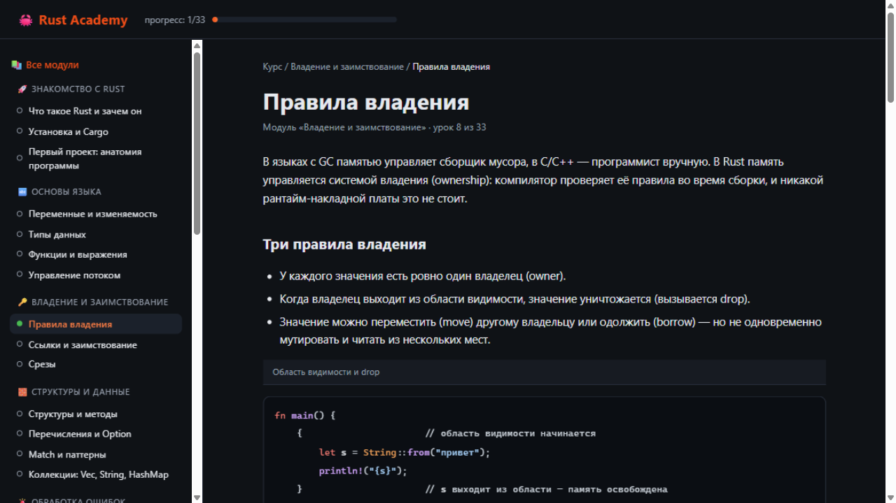
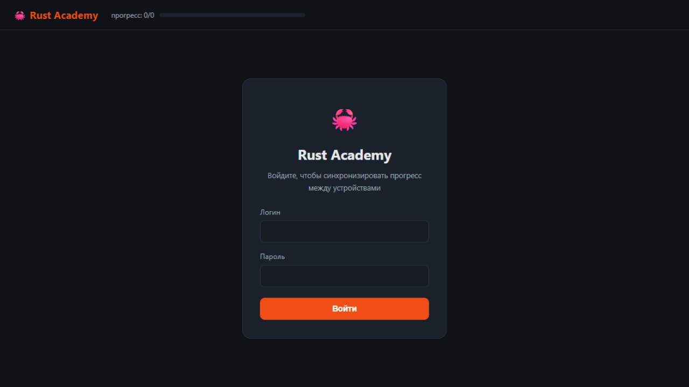

<div align="center">

# 🦀 Rust Academy

**Интерактивная веб-платформа для изучения Rust — от первой переменной до async/await, макросов и unsafe**

Платформа написана на Rust (Axum): учишься по ней — и параллельно читаешь реальный Rust-проект,
на котором она построена.


-brightgreen)

</div>

---

## ✨ Возможности

- 📚 **11 модулей, 33 урока** — теория, примеры кода, тесты и практика в каждом уроке
- ✅ **Тесты с разбором** — мгновенная проверка ответов с объяснением
- 💻 **Практика** — задания со скрытым решением и кнопкой **▶ Playground**: код открывается
  в официальной песочнице [play.rust-lang.org](https://play.rust-lang.org), ничего устанавливать не нужно
- 🎨 **Собственная подсветка синтаксиса** Rust — без внешних библиотек
- 🔐 **Авторизация** — сессии на HttpOnly-cookie, пароли хранятся как salted sha256
- 📱 **Прогресс в SQLite** — синхронизация между телефоном и компьютером,
  офлайн-отметки подтягиваются при следующем входе
- 🪶 **Один бинарник** — весь контент и статика встроены, на сервере не нужны БД и зависимости

## 🖼 Как это выглядит

| Главная | Урок |
|---|---|
|  |  |

| Вход |
|---|
|  |

## 📚 Программа курса

| # | Модуль | Темы |
|---|--------|------|
| 1 | 🚀 Знакомство | что такое Rust, rustup/cargo, анатомия программы |
| 2 | 🔤 Основы | переменные и изменяемость, типы, функции, управление потоком |
| 3 | 🔑 Владение | ownership, ссылки и заимствование, срезы |
| 4 | 🧱 Структуры и данные | struct/impl, enum и Option, match-паттерны, Vec/String/HashMap |
| 5 | 🚨 Обработка ошибок | panic!, Result, оператор `?` |
| 6 | 🧩 Дженерики и трейты | generics, трейты и dyn-объекты, времена жизни |
| 7 | ⚡ Функциональный Rust | замыкания, итераторы, модули и крейты |
| 8 | 🎁 Умные указатели | Box/Deref, Rc/RefCell, внутренняя изменяемость |
| 9 | 🧵 Конкурентность | потоки и каналы, Arc/Mutex, async/await и Tokio |
| 10 | 🧪 Продвинутый Rust | макросы, unsafe, тестирование и doc-тесты |
| 11 | 🏗 Проект: менеджер задач | CLI-приложение с JSON-хранением → REST API на Axum |

## 🚀 Быстрый старт

```bash
git clone <ваш-репозиторий>
cd rust-academy
cargo run
```

Откройте **http://127.0.0.1:8011** и войдите: логин `admin`, пароль `admin`
(при первом запуске создаётся автоматически; сменить можно через `RA_ADMIN_PASSWORD` до первого старта).

| Переменная | По умолчанию | Назначение |
|---|---|---|
| `PORT` | `8011` | порт |
| `HOST` | `127.0.0.1` | интерфейс (`0.0.0.0` — для доступа извне) |
| `RA_DB` | `rust-academy.db` | путь к SQLite-базе |
| `RA_ADMIN_PASSWORD` | `admin` | пароль admin при первом старте |

## 🏗 Архитектура

```
src/
├── main.rs          # Axum-сервер: маршруты, auth-мидлварь, API прогресса
├── auth.rs          # salted sha256, сессионные cookie
├── db.rs            # SQLite: users / sessions / progress
├── render.rs        # серверный HTML-рендеринг с обязательным экранированием
└── content/         # курс — это данные, а не код вёрстки
    ├── mod.rs       # типы: Section, Lesson, Block, Question, Exercise
    └── m01…m11.rs   # по файлу на модуль
static/
├── app.css          # тёмная тема, страница входа
└── app.js           # подсветка, квизы, синхронизация прогресса
```

Сервер рендерит HTML напрямую из данных контента (без шаблонизатора и JS-фреймворка).
Бэкенд: `axum` + `tokio` + `rusqlite` (SQLite встроен в бинарник); фронтенд — один CSS- и один JS-файл.

## ➕ Добавить свой урок

Урок — это константа в `src/content/mXX_*.rs`:

```rust
Lesson {
    id: "my-lesson",               // станет /lesson/my-lesson
    title: "Название урока",
    blocks: vec![ /* параграфы, код, заметки */ ],
    quiz: vec![ /* вопросы с разбором */ ],
    exercise: Some(Exercise { /* задача, стартовый код, решение */ }),
}
```

Маршрут, навигация, сайдбар и счётчики прогресса подхватятся автоматически.
